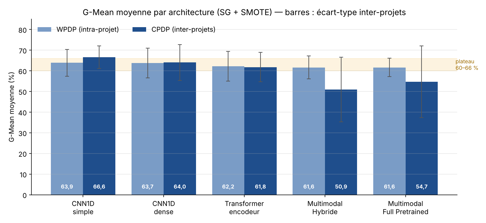
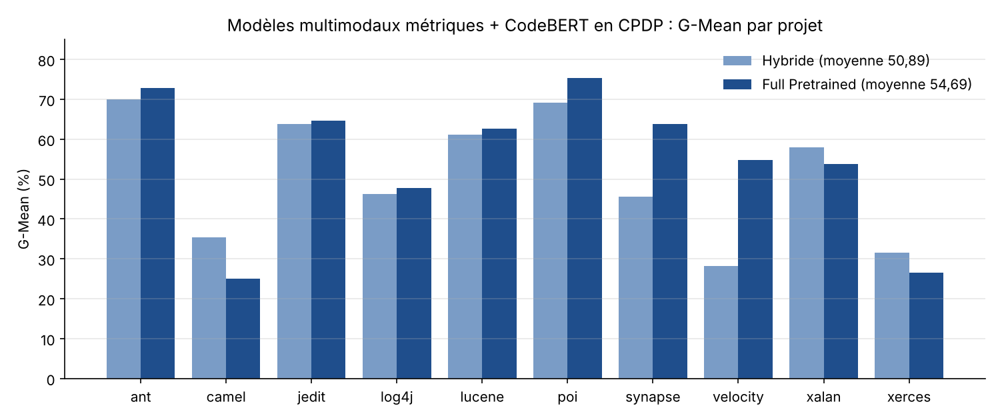
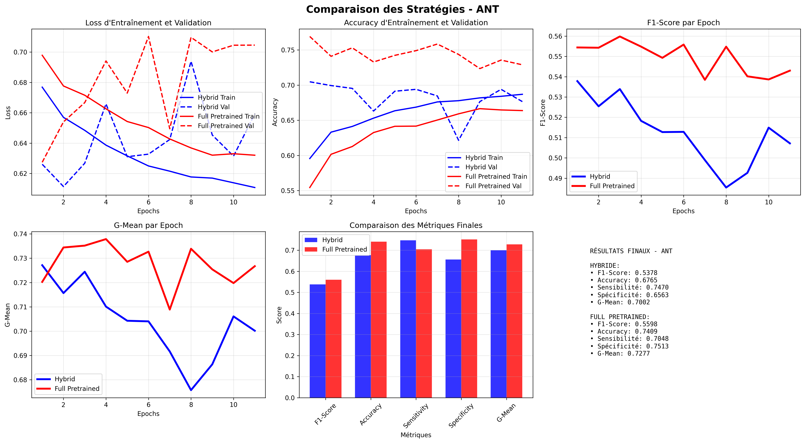
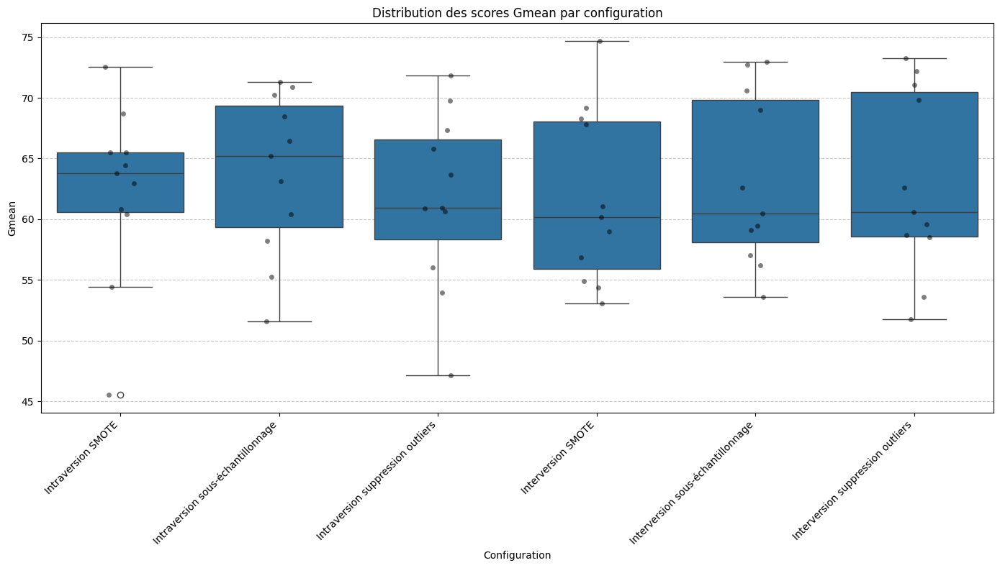
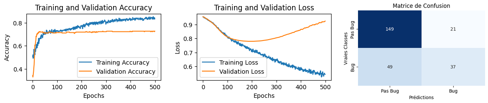

# Prédiction des défauts logiciels : CNN ou Transformers ?

**Analyse comparative des approches de prédiction de fautes logicielles basées sur les architectures CNN et Transformers**

Code et résultats de mon mémoire de maîtrise en mathématiques et informatique appliquées (concentration génie logiciel), Université du Québec à Trois-Rivières (UQTR), février 2026.

[](https://github.com/mireille-kafando/software-defect-prediction-promise/actions/workflows/tests.yml)

[English summary below](#english-summary)

Un article tiré de ce mémoire a été accepté à **WSSE 2026**.

---

## En bref

Prédire quelles classes d'un logiciel contiendront des défauts aide les équipes à cibler leurs tests et leurs revues de code. Le problème est difficile : les classes défectueuses sont minoritaires, si bien qu'un modèle peut afficher une bonne exactitude tout en manquant la plupart des défauts.

Ce travail évalue environ 45 configurations combinant **prétraitement** et **architectures d'apprentissage profond** sur 11 projets Java du corpus PROMISE (41 versions, 15 775 classes, métriques CK), selon un gradient croissant de pré-entraînement :

| Architecture | Paramètres | Entrées | Outils |
|---|---|---|---|
| **CNN1D simple** | ~263K | 20 métriques CK | TensorFlow / Keras |
| **CNN1D dense** (couche dense additionnelle) | ~330K | 20 métriques CK | TensorFlow / Keras |
| **Transformer encodeur** (entraîné de zéro) | ~870K | 20 métriques CK | PyTorch |
| **Multimodal Hybride** (semi-pré-entraîné) | ~130M | Métriques + code source (CodeBERT) | PyTorch, Hugging Face |
| **Multimodal Full Pretrained** (entièrement pré-entraîné) | ~250M | Métriques + code source (CodeBERT) | PyTorch, Hugging Face |

### Questions de recherche

- **RQ1 — Prétraitement :** quel est l'effet des stratégies de standardisation et des techniques d'équilibrage, avec ou sans suppression des valeurs aberrantes ?
- **RQ2 — Architecture :** les Transformers surpassent-ils les CNN1D ?
- **RQ3 — Transférabilité :** comment la performance varie-t-elle entre prédiction intra-projet (WPDP) et inter-projets (CPDP) ?
- **RQ4 — Validation statistique :** les différences observées sont-elles significatives ?

### Protocole expérimental

- **Standardisation** : globale (**SG**, paramètres estimés sur toutes les versions d'entraînement), par version (**SV**), et robuste (**SR**, stratégie hybride proposée dans le mémoire).
- **Équilibrage des classes** : SMOTE, Borderline-SMOTE, sous-échantillonnage aléatoire, sous-échantillonnage après détection des valeurs aberrantes (EllipticEnvelope puis IsolationForest, avec ACP).
- **Validation temporelle**, qui respecte l'ordre des versions :
  - **WPDP** (intra-projet) : entraînement sur les versions 1 à n−1 d'un projet, validation sur sa dernière version n.
  - **CPDP** (inter-projets) : entraînement sur les versions 1 à n−1 du projet cible **et** sur toutes les versions des autres projets, validation sur la dernière version n du projet cible.
- **Métrique principale** : **G-Mean** (moyenne géométrique de la sensibilité et de la spécificité), complétée par l'exactitude, le rapport de classification et la matrice de confusion.
- **Statistiques** : tests de normalité, Friedman, Wilcoxon, Nemenyi, décomposition de la variance (ANOVA).

## Résultats



| Architecture | WPDP (σ) | CPDP (σ) | Δ CPDP − WPDP |
|---|---|---|---|
| CNN1D simple | 63,87 (6,51) | **66,58** (5,49) | +2,71 |
| CNN1D dense | 63,74 (7,25) | 64,03 (8,68) | +0,29 |
| Transformer encodeur | 62,23 (7,23) | 61,79 (7,17) | −0,45 |
| Multimodal Hybride | 61,63 (5,52) | 50,89 (15,63) | −10,74 |
| Multimodal Full Pretrained | 61,59 (4,45) | 54,69 (17,37) | −6,90 |

*G-Mean moyenne en %, SMOTE, standardisation SG (modèles multimodaux : standardisation par version en pratique, voir « Écarts relevés »). σ = écart-type entre projets. Modèles multimodaux : 10 projets (Ivy exclu faute de code source suffisant).*

### Trois constats

1. **Un plateau de performance.** Presque toutes les configurations convergent entre 60 et 66 % de G-Mean, quels que soient le prétraitement et l'architecture. Ce plafond reflète probablement les limites informationnelles des métriques CK statiques plutôt qu'une limite algorithmique.
2. **La simplicité gagne en inter-projets.** Le CNN1D simple obtient la meilleure moyenne et la plus faible variabilité en CPDP. Les modèles multimodaux, environ 500 à 1 000 fois plus gros, sont les plus instables : leur G-Mean CPDP s'effondre sur certains projets (camel, xerces).
3. **Le contexte du projet domine.** Les caractéristiques propres aux projets expliquent environ 77 % de la variance en WPDP, contre 23 % pour les choix méthodologiques. La plupart des comparaisons entre méthodes ne sont pas statistiquement significatives : ce résultat documente les limites actuelles de la prédiction à partir de métriques statiques.

### Résultats détaillés

| Fichier | Contenu |
|---|---|
| [`results/cnn1d_simple_gmean.csv`](results/cnn1d_simple_gmean.csv) | CNN1D simple, 11 projets × {SG, SV, SR} × {WPDP, CPDP} |
| [`results/cnn1d_dense_gmean.csv`](results/cnn1d_dense_gmean.csv) | CNN1D dense, mêmes configurations |
| [`results/transformer_encodeur_gmean.csv`](results/transformer_encodeur_gmean.csv) | Transformer encodeur, 3 techniques d'équilibrage × {WPDP, CPDP} |
| [`results/multimodal_wpdp_cpdp.csv`](results/multimodal_wpdp_cpdp.csv) | Hybride et Full Pretrained : G-Mean, exactitude, sensibilité, spécificité, F1 |

Les G-Mean CPDP des modèles multimodaux sont celles calculées par le notebook, égales à √(sensibilité × spécificité). Elles corrigent des erreurs de transcription du tableau 12 du mémoire.

### Modèles multimodaux en CPDP : G-Mean par projet



Courbes d'apprentissage et métriques finales pour chaque projet dans [`results/figures/`](results/figures/), par exemple :



### Analyses statistiques

Chaque comparaison suit le même enchaînement :
1. test de normalité de Shapiro-Wilk, avec graphique Q-Q ;
2. test paramétrique (t de Student, ANOVA, ANOVA à mesures répétées) ou non paramétrique (Wilcoxon, Mann-Whitney, Kruskal-Wallis, Friedman) selon le résultat ;
3. comparaisons par paires.

Aucun choix de prétraitement n'a d'effet significatif sur la G-Mean au seuil de 5 % : standardisation, technique d'équilibrage, WPDP contre CPDP, profondeur du CNN1D, dimension du Transformer. Pour le Transformer encodeur, le test de Friedman sur six configurations donne χ² = 1,34 (p = 0,93). L'exactitude, elle, diffère souvent entre WPDP et CPDP, ce qui justifie le choix de la G-Mean.

Entre architectures en CPDP, en revanche, le CNN1D simple fait significativement mieux que le Transformer encodeur (Wilcoxon, p = 0,014) et que l'Hybride (Friedman χ² = 7,8, p = 0,020, W de Kendall = 0,39 ; Nemenyi, p = 0,020). La décomposition de variance (ANOVA à trois facteurs) attribue environ 77 % de la variance au projet en WPDP et 60 % en CPDP.

Un notebook de reproduction recalcule à partir des CSV les tests du mémoire (tableaux 15 à 17) et compare chaque valeur à celle publiée.

Résultats détaillés, tableaux de tests et figures : [`results/statistiques/`](results/statistiques/). Reproduction des tableaux 15 à 17 : [`notebooks/07_reproduction_statistique/`](notebooks/07_reproduction_statistique/).

<p align="center"></p>

### Courbes d'apprentissage

| Modèle | Exécution | Figure |
|---|---|---|
| CNN1D | WPDP, version évaluée synapse 1.2 (Adam, lr 1e-5, 500 époques) | [`cnn1d_synapse_wpdp.png`](results/figures/courbes_apprentissage/cnn1d_synapse_wpdp.png) |
| CNN1D | version évaluée xerces 1.4.4, entraînement multi-projets (Adam, lr ≈ 4,6e-4, lot de 8) | [`cnn1d_xerces.png`](results/figures/courbes_apprentissage/cnn1d_xerces.png) |
| Transformer encodeur | 100 époques, version évaluée camel 1.6 | [`transformer_encodeur_camel.png`](results/figures/courbes_apprentissage/transformer_encodeur_camel.png) |
| Hybride et Full Pretrained | CPDP, un graphique par projet | [`results/figures/comparison_*.png`](results/figures/) |



Ces courbes montrent un écart croissant entre entraînement et validation, signe de surapprentissage. Pour le CNN1D, l'arrêt précoce restaure les poids de l'époque où la perte sur la version évaluée est la plus faible (voir « Écarts relevés »). Le Transformer encodeur est entraîné sur 100 époques fixes.

## Organisation du dépôt

```
notebooks/
├── 01_cnn1d/
│   ├── 01_cnn1d_exploration.ipynb                 Premiers essais CNN1D (Keras)
│   ├── 02_cnn1d_couche_dense.ipynb                Variante dense, SG/SV/SR, WPDP/CPDP
│   └── 03_cnn1d_final.ipynb                       CNN1D retenu pour le mémoire
├── 02_analyse_cnn1d/
│   └── analyse_statistique_cnn1d.ipynb            Shapiro-Wilk, ANOVA, Kruskal-Wallis, t, Wilcoxon, Friedman, Spearman
├── 03_transformer/
│   └── transformer_metriques.ipynb                Encodeur Transformer retenu (PyTorch)
├── 04_analyse_transformer/
│   └── analyse_statistique_transformer.ipynb      ANOVA à mesures répétées, Friedman, Wilcoxon, Tukey HSD
├── 05_multimodal/                                 Métriques + code source (CodeBERT)
│   ├── 01_exploration_outliers_reechantillonnage.ipynb   Essais + agrégation des résultats
│   ├── 02_alignement_metriques_code.ipynb
│   ├── 03_variantes_hybride_fullpretrained.ipynb
│   ├── 04_encodeur_decodeur_reechantillonnage.ipynb
│   ├── 05_hybride_fullpretrained_wpdp.ipynb        Hybride et Full Pretrained, WPDP
│   └── 06_pipeline_cpdp_exploratoire.ipynb         Essais inter-projets antérieurs
├── 06_figures_memoire/                            Figures, tableaux, statistiques descriptives
└── 07_reproduction_statistique/
    └── reproduction_tableaux_15_17.ipynb          Friedman, W de Kendall, Nemenyi, ANOVA à trois facteurs (2026)
scripts/
└── multimodal_cpdp_hybride_fullpretrained.py      Hybride et Full Pretrained, CPDP (prototype retenu, rendu exécutable en 2026)
tests/                                             Tests automatisés (pytest), exécutés par GitHub Actions
results/                                           Résultats CSV et figures
├── statistiques/                                  Résultats des tests statistiques et figures associées
└── figures/courbes_apprentissage/                 Courbes d'apprentissage CNN1D et Transformer
data/README.md                                     Obtenir les données PROMISE
docs/genealogie_scripts.md                         Filiation des versions des scripts multimodaux
```

Chaque notebook commence par une cellule qui décrit son rôle et son statut (retenu ou exploratoire). Les sorties d'exécution ont été retirées pour alléger le dépôt ; les résultats des tests statistiques et les principales figures sont repris dans `results/`. Les notebooks exploratoires sont conservés pour la transparence : ils montrent les itérations qui ont mené aux versions retenues.

## Traçabilité : du mémoire au code

Chaque script retenu a été comparé aux définitions du mémoire final (chapitre 4) et, quand c'était possible, aux sorties imprimées par le notebook lui-même.

| Élément du mémoire | Notebook | Vérification |
|---|---|---|
| CNN1D, §4.3.1, tableaux 9 et 10 | `01_cnn1d/03_cnn1d_final` | 3 × Conv1D(256, noyau 2), dropout 0,25 → 0,5, L2 0,01 : conforme. Le notebook imprime 329 730 paramètres pour la variante dense ; la variante simple en compte 263 938. |
| Standardisation SG / SV, §4.2.1 | `01_cnn1d/03_cnn1d_final` | Cellules SG et SV présentes ; seuil σ ≤ 1e-5 conforme. |
| Encodeur Transformer, §4.3.2, tableau 11 | `03_transformer/transformer_metriques` | 40 dimensions, 5 couches, 4 têtes, dropout 0,3, lr 1e-5, 100 époques : conforme au texte. Le notebook imprime 872 682 paramètres. |
| Hybride et Full Pretrained, §4.3.2, tableau 12 (WPDP) | `05_multimodal/05_hybride_fullpretrained_wpdp` | LazyLinear → 384, 2 couches, `from_pretrained("microsoft/codebert-base")`, `Linear(768, 384)`, attention croisée : conforme. |
| Hybride et Full Pretrained, tableau 12 (CPDP) | `scripts/multimodal_cpdp_hybride_fullpretrained.py` | Protocole CPDP conforme (versions 1 à n−1 + tous les autres projets). Produit les fichiers de résultats par projet dont viennent les G-Mean publiées. Voir les réserves ci-dessous. |
| Tests statistiques, §4.5.2 | `02_analyse_cnn1d`, `04_analyse_transformer` | Shapiro-Wilk, ANOVA, Kruskal-Wallis, Friedman, Wilcoxon. |
| Tableaux 15, 16 et 17 | `07_reproduction_statistique` | Recalculés en 2026 à partir de `results/` ; concordance détaillée dans `results/statistiques/`. |
| Corpus, tableaux 6 et 7, annexe 1 | `06_figures_memoire/statistiques_descriptives` | 11 projets, 41 versions, 15 775 classes. |

### Écarts relevés

La filiation des versions successives des scripts multimodaux et les points de méthode associés sont détaillés dans [`docs/genealogie_scripts.md`](docs/genealogie_scripts.md).

Les résultats du mémoire et de l'article sont présentés tels qu'ils ont été obtenus et publiés. La vérification du code après publication a mis en évidence les écarts et erreurs ci-dessous. Ils sont rapportés ici par transparence. Leur correction fera l'objet d'un second article.

- **Nombre de paramètres.** Les ordres de grandeur du mémoire (~120K pour le CNN1D simple, ~500K pour l'encodeur) sont des estimations. Les valeurs calculées à partir du code sont données dans le tableau de la section « En bref ».
- **Tableau 8 du mémoire.** Les hyperparamètres indiqués pour l'encodeur entraîné de zéro (384 dimensions, 8 têtes, 2 couches) sont ceux de l'encodeur de métriques du modèle Hybride. L'encodeur unimodal utilise la configuration décrite dans le texte (40 dimensions, 5 couches, 4 têtes).
- **Modèles multimodaux en CPDP.** Le script retenu a été retrouvé dans le document de travail de l'autrice ; les résultats conservés en ont exactement la structure. Tel qu'il a été conservé, le modèle Full Pretrained ne s'exécutait pas (métriques projetées en 384 dimensions, CodeBERT en attend 768) : la version qui a produit les résultats Full Pretrained comportait une adaptation 384 ↔ 768, conforme au §4.3.2 mais non conservée. Synapse figurait dans les résultats mais pas dans la liste de projets du script. En 2026, le script a été rendu exécutable par trois modifications repérées « [2026] » dans le code : la projection `nn.Linear(384, 768)` décrite au §4.3.2, l'ajout de Synapse et des chemins configurables. Avec l'architecture de CodeBERT, l'Hybride et le Full Pretrained comptent alors exactement 130 306 050 et 250 910 978 paramètres. Ces modifications ne touchent ni au protocole ni aux points de méthode de cette liste. La [version conservée](https://github.com/mireille-kafando/software-defect-prediction-promise/blob/409c1a9/scripts/multimodal_cpdp_hybride_fullpretrained.py) reste consultable.
- **Standardisation des modèles multimodaux.** Chaque version passe par son propre `StandardScaler`, y compris la version évaluée. Il s'agit donc en pratique d'une standardisation par version (SV) transductive, et non de la standardisation globale (SG) indiquée au tableau 12, où elle est notée « S1 ».
- **Arrêt précoce et sélection du modèle.** Il n'y a pas de jeu de validation distinct de la dernière version évaluée : l'arrêt précoce du CNN1D (`restore_best_weights=True`) et la sélection du « meilleur » modèle dans les scripts multimodaux sont pilotés par l'ensemble dont le score est rapporté, ce qui peut rendre les G-Mean optimistes. L'encodeur Transformer unimodal (100 époques fixes) n'est pas concerné.
- **Alignement métriques ↔ code.** La fonction d'alignement du prototype tronque les noms qualifiés au nom du paquetage (`org.apache.tools.ant.Main` devient `orgapachetoolsant`). Mesuré sur le corpus réel, elle ne relie que 0,7 % des classes à leur propre fichier, et chaque version ne reçoit qu'entre 1 et 34 fichiers distincts. Si c'est bien cette fonction qui a produit les résultats multimodaux, ces modèles ont vu un code presque identique d'une classe à l'autre, ce qui pourrait expliquer l'absence de gain du multimodal.
- **Filtre de variance.** Quelques cellules exploratoires du notebook CNN1D inversent le filtre (elles retirent les colonnes de variance non nulle) ou utilisent un seuil de 1e-4. Les cellules retenues appliquent le seuil σ ≤ 1e-5 décrit au §2.2.2.

## Reproduire les expériences

1. Obtenir les données PROMISE et le code source des projets (voir [`data/README.md`](data/README.md)).
2. Ouvrir un notebook dans Google Colab (GPU recommandé pour les modèles CodeBERT), ou localement après `pip install -r requirements.txt`.
3. Dans les notebooks, adapter les chemins `/content/drive/MyDrive/bug/...` à l'emplacement des données. Le script multimodal lit ses chemins dans des variables d'environnement :

```bash
SDP_DATA_DIR=bug-data/ SDP_SOURCE_DIR=bug-data/source-code/source-code/ SDP_RESULTS_DIR=resultats/ \
python scripts/multimodal_cpdp_hybride_fullpretrained.py
```

Les notebooks sont des notebooks de recherche : ils gardent la trace des itérations successives et ne constituent pas une bibliothèque prête à l'emploi.

### Tests

```bash
pip install -r requirements-tests.txt
pytest
```

Les tests s'exécutent sans les données PROMISE ni les poids de CodeBERT, en moins d'une minute sur processeur. Ils vérifient :
- la cohérence des fichiers de `results/` (projets, plages de valeurs, G-Mean = √(sensibilité × spécificité)) ;
- les tests statistiques du tableau 15 reproduits à partir de ces fichiers ;
- le script multimodal : passe avant des deux modèles, nombres de paramètres, fonctions de préparation et d'évaluation, et un entraînement CPDP complet sur des données synthétiques ;
- l'exécution complète du notebook de reproduction statistique.

GitHub Actions les relance à chaque modification du dépôt.

## Compétences mises en œuvre

Python · TensorFlow/Keras · PyTorch · Hugging Face Transformers (CodeBERT) · scikit-learn · imbalanced-learn · pandas · SciPy/statsmodels (Shapiro-Wilk, ANOVA, ANOVA à mesures répétées, Kruskal-Wallis, Friedman, Wilcoxon, Tukey HSD, Nemenyi, W de Kendall, ANOVA à trois facteurs, corrélations de Spearman) · Matplotlib/Seaborn · pytest · GitHub Actions · Google Colab

## Auteure

**Mireille Kafando**, M. Sc. en mathématiques et informatique appliquées (génie logiciel), UQTR

Sous la direction des professeurs **Mourad Badri** et **Fadel Touré**, Département de mathématiques et d'informatique, UQTR.

[LinkedIn](https://www.linkedin.com/in/mireille-kafando-386b2a420/) · [Portfolio](https://mireille-kafando.github.io) · [GitHub](https://github.com/mireille-kafando)

---

## English summary

Code and results from my master's thesis (Université du Québec à Trois-Rivières, 2026): *a comparative analysis of CNN- and Transformer-based approaches to software defect prediction*.

- **Scope:** about 45 configurations on 11 Java projects from the PROMISE corpus (41 versions, 15,775 classes, CK metrics), combining three standardization strategies (global, per-version, robust), several class-balancing techniques (SMOTE, Borderline-SMOTE, random undersampling, outlier-aware undersampling) and five architectures: simple and dense 1D CNNs (Keras), a Transformer encoder trained from scratch (PyTorch), and two multimodal models fusing metrics with **CodeBERT** source-code embeddings (semi-pretrained and fully pretrained).
- **Evaluation:** time-aware validation in **within-project (WPDP)** and **cross-project (CPDP)** settings, with **G-Mean** as the main metric, plus Friedman, Wilcoxon and Nemenyi tests and ANOVA variance decomposition.
- **Findings:** (1) performance converges on a 60–66% G-Mean plateau, which likely reflects the information limits of static CK metrics; (2) the simple 1D CNN is the best and most stable model in CPDP (66.6%), while the multimodal models, 500–1,000× larger, are the least stable (50.9% and 54.7%); (3) project characteristics explain about 77% of performance variance, versus 23% for methodological choices.
- **Statistics:** Shapiro-Wilk normality checks, then parametric or non-parametric tests (t-test, ANOVA, repeated-measures ANOVA, Kruskal-Wallis, Friedman, Wilcoxon). No preprocessing choice significantly affects G-Mean at α = 0.05; in CPDP the simple 1D CNN significantly outperforms the Transformer encoder (p = 0.014) and the Hybrid model (Friedman p = 0.020, Nemenyi p = 0.020). A reproduction notebook recomputes thesis Tables 15–17 (Kendall's W, Nemenyi, three-way ANOVA) from the CSV files. Details and figures in `results/statistiques/`; learning curves in `results/figures/courbes_apprentissage/`.
- **Known limitations:** results are reported as published. A post-publication code review found several issues (early stopping driven by the evaluated version, per-version scaling in the multimodal models, and a metrics-to-code alignment that matched only 0.7% of classes to their own file). They are documented in *Écarts relevés* and will be addressed in a follow-up paper.
- **Code and tests:** the multimodal CPDP script was made runnable in 2026 through three marked changes (the 384 → 768 projection described in the thesis, the missing Synapse project, configurable paths), with no change to the protocol. A pytest suite, run by GitHub Actions on every push, checks the result files, the reproduced statistical tests, both multimodal models (forward pass, exact parameter counts, an end-to-end CPDP run on synthetic data) and the reproduction notebook.
- **Traceability:** each retained notebook is mapped to the thesis section and table it supports, with the code-versus-text discrepancies found during verification (see *Traçabilité* above).

Supervised by Profs. Mourad Badri and Fadel Touré (UQTR). A paper based on this thesis was accepted at WSSE 2026.

Data are not redistributed; see `data/README.md`.
