# Analyses statistiques

Cette page rassemble les résultats des tests statistiques exécutés dans les notebooks d'analyse du mémoire. Les valeurs sont recopiées des sorties d'exécution, sans recalcul :

- CNN1D : [`02_analyse_cnn1d/analyse_statistique_cnn1d`](../../notebooks/02_analyse_cnn1d/analyse_statistique_cnn1d.ipynb) ;
- Transformer encodeur : [`04_analyse_transformer/analyse_statistique_transformer`](../../notebooks/04_analyse_transformer/analyse_statistique_transformer.ipynb).

Dans le dépôt, ces notebooks sont présentés sans leurs sorties pour rester légers. Les cellules citées ci-dessous permettent de retrouver chaque test.

*English summary at the end.*

## Démarche

Chaque comparaison suit la même logique :

1. **Normalité** de chaque série (ou des différences appariées) par le test de **Shapiro-Wilk**, avec un graphique Q-Q.
2. **Test de comparaison** choisi selon le résultat :
   - test paramétrique si la normalité est acceptée : t de Student, ANOVA à un facteur ou ANOVA à mesures répétées ;
   - test non paramétrique sinon : Wilcoxon, Mann-Whitney, Kruskal-Wallis ou Friedman.
3. **Comparaisons par paires** (Wilcoxon, Tukey HSD) pour situer les écarts entre configurations.

Toutes les comparaisons portent sur la **G-Mean** obtenue sur les 11 projets PROMISE. Le seuil est α = 0,05.

## 1. Corpus : distribution des métriques

Métriques des 41 versions, sur les 14 866 classes chargées dans le notebook (cellule 80) :

| Métrique | Shapiro-Wilk W | p | Asymétrie | Aplatissement |
|---|---|---|---|---|
| LOC | 0,329 | < 10⁻¹⁰⁰ | 12,3 | 272,0 |
| NOC | 0,132 | < 10⁻¹⁰⁰ | 19,5 | 578,4 |
| CBO | 0,442 | < 10⁻¹⁰⁰ | 8,6 | 134,3 |
| MAX_CC | 0,373 | < 10⁻¹⁰⁰ | 11,7 | 229,2 |

Corrélations de Spearman : LOC–MAX_CC ρ = 0,73 ; CBO–LOC ρ = 0,44 ; CBO–MAX_CC ρ = 0,39 ; CBO–NOC ρ = 0,24 ; NOC–LOC ρ = 0,09 ; NOC–MAX_CC ρ = 0,09. Toutes ont p < 0,001.

Les métriques sont très asymétriques, avec des queues lourdes. C'est ce qui justifie la standardisation et les tests non paramétriques sur les données brutes.

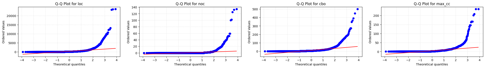

  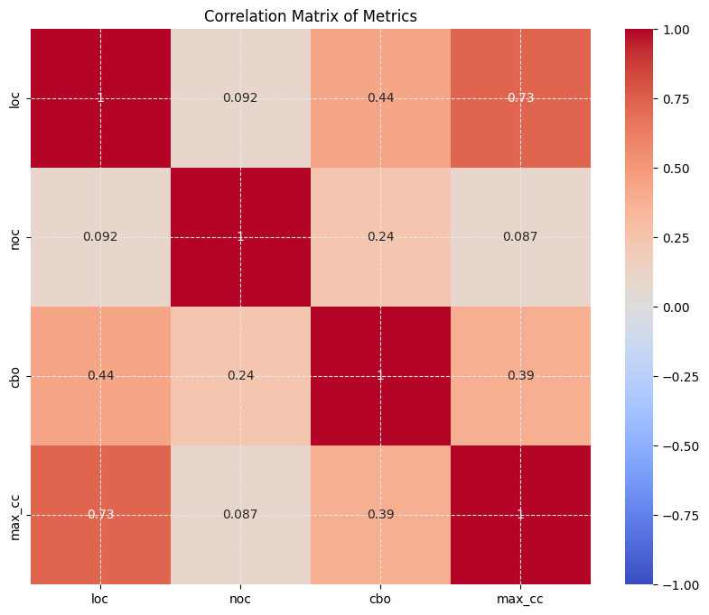
  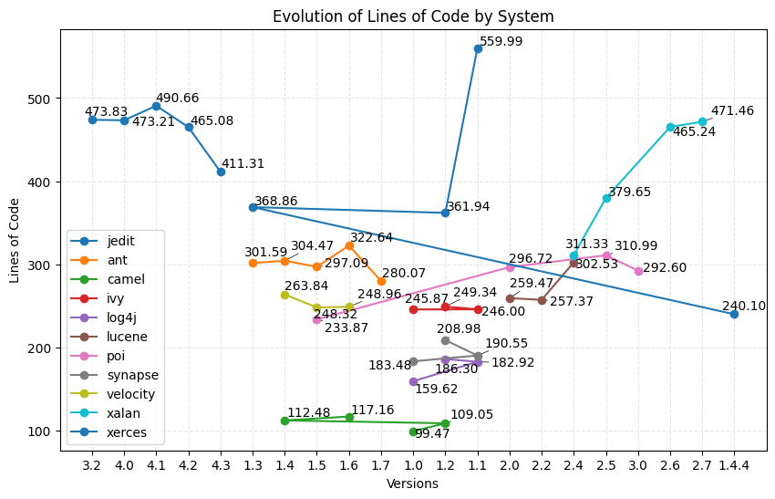

## 2. CNN1D

### 2.1 Effet de la standardisation (SG, SV, SR)

| Architecture | Protocole | Normalité (p Shapiro SG / SV / SR) | Test | Statistique | p |
|---|---|---|---|---|---|
| Simple | WPDP | 0,40 / 0,26 / 0,25 | ANOVA à un facteur | F = 0,143 | 0,868 |
| Dense | WPDP | 0,93 / **0,027** / 0,26 | Kruskal-Wallis | H = 0,391 | 0,823 |
| Simple | CPDP | 0,51 / 0,24 / 0,74 | ANOVA à un facteur | F = 0,520 | 0,600 |
| Dense | CPDP | 0,08 / **0,010** / 0,18 | Kruskal-Wallis | H = 0,181 | 0,914 |
| Dense | CPDP | — | Friedman | χ² = 0,545 | 0,761 |

Cellules 8, 10, 12, 14 et 26. **Aucun effet significatif de la standardisation sur la G-Mean.**

Sur l'exactitude moyenne, en revanche, la standardisation a un effet significatif en CPDP :
- CNN1D simple : Kruskal-Wallis H = 13,90, p = 0,001 ;
- CNN1D dense : H = 10,54, p = 0,005 ;
- CNN1D dense, test de Friedman : χ² = 6,73, p = 0,035.

### 2.2 WPDP contre CPDP, à standardisation égale (tests appariés)

| Architecture | Standardisation | G-Mean : test, p | Exactitude : test, p |
|---|---|---|---|
| Simple | SG | t apparié, p = 0,236 | t apparié, **p = 0,001** |
| Simple | SV | Wilcoxon, p = 0,898 | t apparié, **p = 0,047** |
| Simple | SR | t apparié, p = 0,470 | t apparié, p = 0,095 |
| Dense | SG | Wilcoxon, p = 0,898 | t apparié, **p < 0,001** |
| Dense | SV | t apparié, p = 0,942 | t apparié, **p = 0,013** |
| Dense | SR | t apparié, p = 0,741 | t apparié, **p = 0,023** |

Cellules 16 et 29. **La G-Mean ne diffère jamais entre WPDP et CPDP.** L'exactitude, elle, diffère le plus souvent : c'est la raison pour laquelle le mémoire retient la G-Mean, moins sensible au déséquilibre des classes.

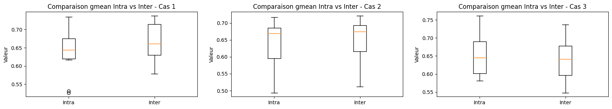

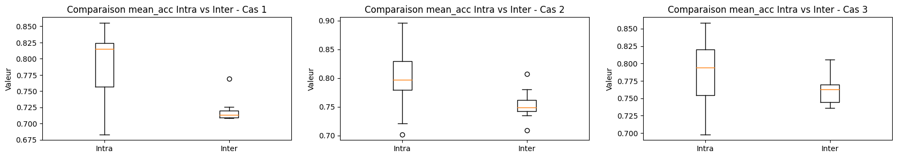

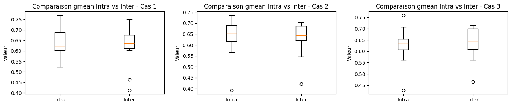

Ordre des boîtes à moustaches : cas 1 = SG, cas 2 = SV, cas 3 = SR.

### 2.3 Simple contre dense, et WPDP contre CPDP en moyenne

Ces comparaisons partent de fichiers Excel de moyennes par projet (cellules 2 à 6) :

| Comparaison | Normalité (p) | Test | t | p |
|---|---|---|---|---|
| Simple contre dense, WPDP | 0,93 / 0,13 | t de Student | 0,359 | 0,723 |
| Simple contre dense, CPDP | 0,43 / 0,50 | t de Student | 0,909 | 0,374 |
| WPDP contre CPDP, CNN1D dense | 0,13 / 0,50 | t de Student | 0,127 | 0,900 |
| WPDP contre CPDP, CNN1D simple | 0,93 / 0,43 | t de Student | −0,339 | 0,738 |

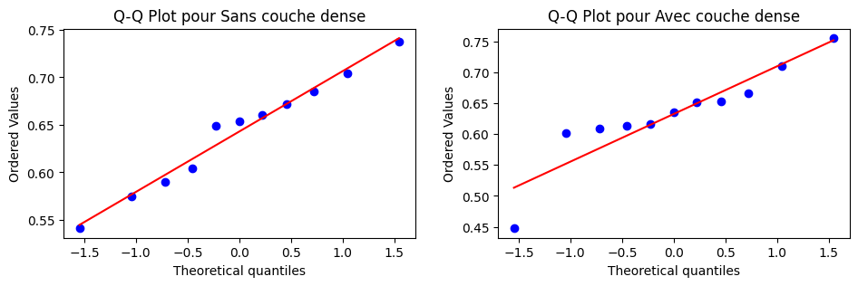

## 3. Transformer encodeur

### 3.1 Protocole × technique d'équilibrage (6 configurations, cellule 25)

| Configuration | G-Mean moyenne (%) | Shapiro-Wilk p |
|---|---|---|
| WPDP + SMOTE | 62,23 | 0,238 |
| WPDP + sous-échantillonnage | 63,75 | 0,422 |
| WPDP + suppression des valeurs aberrantes | 61,64 | 0,849 |
| CPDP + SMOTE | 61,76 | 0,340 |
| CPDP + sous-échantillonnage | 63,07 | 0,175 |
| CPDP + suppression des valeurs aberrantes | 62,88 | 0,256 |

- **ANOVA à mesures répétées** : p = 0,967.
- **Friedman** : χ² = 1,338, p = 0,931.
- **Wilcoxon par paires** (9 paires) : aucune paire significative ; la p la plus faible est 0,102 (CPDP SMOTE contre CPDP sous-échantillonnage).

  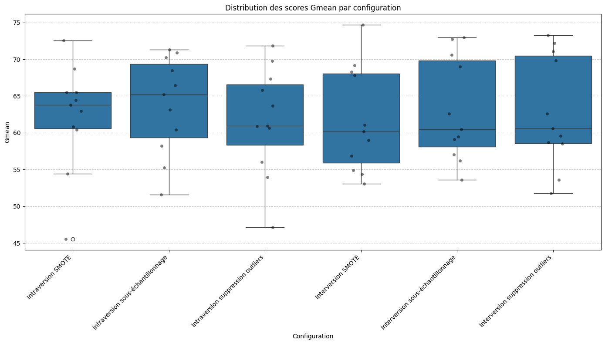
  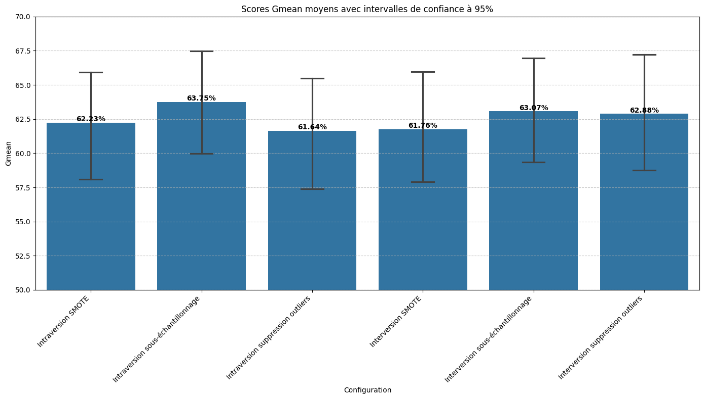

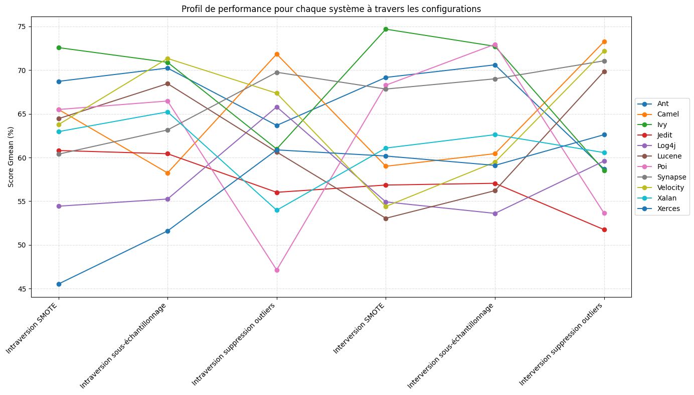

### 3.2 Autres comparaisons

| Comparaison | ANOVA MR, p | Friedman | Cellule |
|---|---|---|---|
| Techniques d'équilibrage en CPDP (3 techniques) | 0,300 | χ² = 2,279, p = 0,320 | 18 |
| Dimension du modèle 20 contre 40, WPDP et CPDP (4 configurations) | 0,894 | χ² = 0,600, p = 0,896 | 28 |

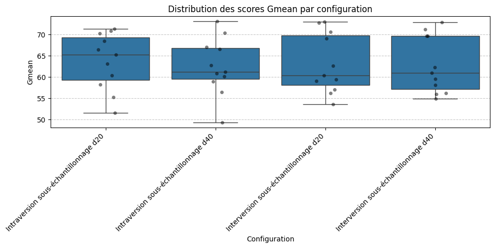

## 4. Conclusion des tests des notebooks

Aucune des comparaisons de G-Mean entre choix de prétraitement n'est significative au seuil de 5 % : standardisation, technique d'équilibrage, protocole WPDP/CPDP, profondeur du CNN1D, dimension du Transformer. Les écarts entre configurations (1 à 2 points) restent faibles devant la variabilité entre projets (écart type d'environ 7 points). Ce constat rejoint la conclusion du mémoire : les caractéristiques des projets pèsent davantage que les choix méthodologiques. Les seules différences significatives opposent des architectures en CPDP (section 5).

## 5. Reproduction des tableaux 15, 16 et 17 du mémoire

Plusieurs analyses du mémoire ne figurent pas dans les notebooks d'analyse conservés : le W de Kendall, les tests post-hoc, la décomposition de variance (ANOVA à trois facteurs) et les comparaisons entre architectures. Le notebook [`07_reproduction_statistique/reproduction_tableaux_15_17`](../../notebooks/07_reproduction_statistique/reproduction_tableaux_15_17.ipynb), ajouté en 2026, les **recalcule à partir des G-Mean de `results/`** et compare chaque valeur à celle publiée. Il est présenté avec ses sorties ; les tableaux produits sont dans [`reproduction/`](reproduction/).

### 5.1 Tableau 15 : Friedman, Wilcoxon et W de Kendall

| Comparaison | Contexte | N | Test | Recalculé | Mémoire | Concorde |
|---|---|---|---|---|---|---|
| SG vs SV vs SR (CNN1D simple) | WPDP | 11 | Friedman | χ² = 0,727 ; p = 0,695 ; W = 0,033 | identique | oui |
| SG vs SV vs SR (CNN1D simple) | CPDP | 11 | Friedman | χ² = 2,182 ; p = 0,336 ; W = 0,099 | identique | oui |
| CNN1D simple vs dense (SG) | WPDP | 11 | Wilcoxon | 28,0 ; p = 0,700 | identique | oui |
| CNN1D simple vs dense (SG) | CPDP | 11 | Wilcoxon | 23,0 ; p = 0,413 | identique | oui |
| SMOTE vs sous-éch. vs outliers (encodeur) | WPDP | 11 | Friedman | χ² = 2,364 ; p = 0,307 ; W = 0,107 | χ² = 2,600 ; p = 0,273 (N = 10) | non |
| CNN1D simple vs Transformer encodeur | CPDP | 11 | Wilcoxon | 6,0 ; **p = 0,014** | identique | oui |
| CNN1D vs encodeur vs Hybride | CPDP | 10 | Friedman | χ² = 7,800 ; **p = 0,020** ; W = 0,390 | χ² = 5,600 ; p = 0,061 | non |
| CNN1D vs encodeur vs Full Pretrained | CPDP | 10 | Friedman | χ² = 5,400 ; p = 0,067 ; W = 0,270 | χ² = 6,200 ; p = 0,045 | non |

Six des huit lignes sont reproduites à l'identique.

- **Les deux comparaisons multimodales.** Elles diffèrent parce que le mémoire utilisait les G-Mean de son tableau 12, qui comportent des erreurs de transcription. Avec les valeurs recalculées, √(sensibilité × spécificité), le test avec l'Hybride donne χ² = 7,800, la valeur retenue dans l'article WSSE 2026. Le test avec le Full Pretrained n'est plus significatif.
- **L'équilibrage de l'encodeur.** La série de 10 projets utilisée dans le mémoire n'a pas pu être identifiée : aucun retrait d'un seul projet ne redonne χ² = 2,600.

### 5.2 Post-hoc de Nemenyi

Pour la comparaison significative CNN1D – Transformer encodeur – Hybride en CPDP :
- rangs moyens : CNN1D simple 1,3 ; encodeur 2,2 ; Hybride 2,5 ;
- **seule la paire CNN1D simple – Hybride diffère significativement** (p = 0,020) ;
- les paires CNN1D – encodeur (p = 0,109) et encodeur – Hybride (p = 0,780) ne diffèrent pas.

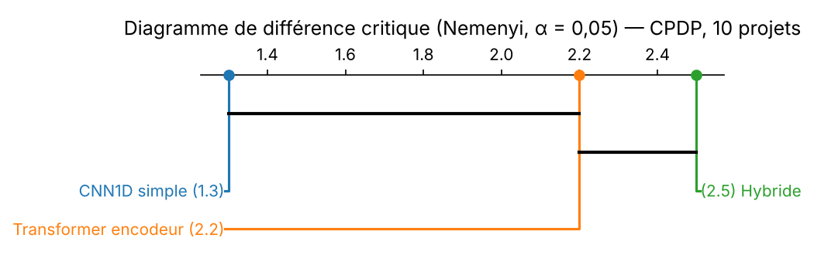

### 5.3 Tableaux 16 et 17 : décomposition de variance (ANOVA à trois facteurs)

Facteurs : projet (11), standardisation (3), architecture CNN1D (2), soit 66 observations par contexte. Le modèle comprend les effets principaux et les interactions d'ordre 2.

| Source | WPDP recalculé | WPDP mémoire | CPDP recalculé | CPDP mémoire |
|---|---|---|---|---|
| Projet | **77,3 %** (F = 24,3 ; p < 0,001) | 77,0 % | **59,8 %** (F = 11,0 ; p < 0,001) | 60,3 % |
| Standardisation | 0,0 % (p = 0,967) | 0,1 % | 0,9 % (p = 0,439) | 1,0 % |
| Architecture | 0,5 % (p = 0,209) | 0,4 % | 1,2 % (p = 0,147) | 1,2 % |
| Projet × standardisation | 9,5 % | 11,7 % | 18,3 % | 18,2 % |
| Projet × architecture | 5,8 % | 4,5 % | 8,4 % | 8,4 % |
| Standardisation × architecture | 0,5 % | 0,3 % | 0,4 % | 0,4 % |
| Résiduelle | 6,4 % | 6,0 % | 10,9 % | 10,7 % |
| Somme des carrés totale | 3 410 | 3 149 | 3 187 | 3 157 |

- **CPDP (tableau 17)** : reproduit à quelques dixièmes de point près.
- **WPDP (tableau 16)** : même structure, mais des écarts plus marqués. Le tableau a probablement été calculé sur une version légèrement différente des G-Mean.

Dans les deux contextes, la conclusion du mémoire tient : le projet explique l'essentiel de la variance, et ni la standardisation ni l'architecture n'ont d'effet significatif.

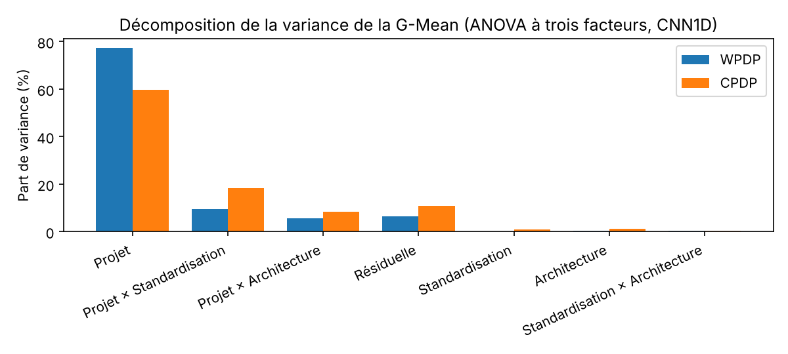

## Écarts relevés dans les analyses

Les notebooks sont présentés tels qu'ils ont été exécutés. Une relecture a mis en évidence les points suivants :

- **Tests pour échantillons indépendants sur des données appariées.** Les 11 projets sont les mêmes d'une configuration à l'autre. Pourtant :
  - les cellules 2 à 6 utilisent le t de Student pour échantillons indépendants (`ttest_ind`) ;
  - les cellules 8 à 14 utilisent l'ANOVA à un facteur et Kruskal-Wallis, qui supposent des groupes indépendants.

  Les tests appariés adaptés à ce plan (t apparié, Wilcoxon, ANOVA à mesures répétées, Friedman) sont ceux des cellules 16, 26 et 29 et du notebook du Transformer. Pour la G-Mean, ils mènent à la même conclusion.
- **Comparaisons multiples.** Les nombreuses comparaisons par paires (Wilcoxon) sont faites sans correction de Bonferroni ni de Holm. Comme aucune n'est significative pour la G-Mean, la conclusion n'en dépend pas. En revanche, les écarts d'exactitude significatifs de la section 2.2 seraient en partie à réexaminer avec une correction.
- **Effectif du corpus.** L'analyse des métriques porte sur 14 866 classes, alors que le corpus en compte 15 775. Une partie des lignes n'a pas été chargée ou a été écartée dans cette cellule.

## English summary

Results of the statistical tests run in the thesis analysis notebooks, copied from their execution outputs:

- **Method:** Shapiro-Wilk normality checks, then a parametric test (t-test, ANOVA, repeated-measures ANOVA) or a non-parametric one (Wilcoxon, Mann-Whitney, Kruskal-Wallis, Friedman).
- **Findings:** no preprocessing choice has a significant effect on G-Mean at α = 0.05 (standardization, balancing, WPDP vs CPDP, CNN1D depth, Transformer width). Between architectures in CPDP, the simple 1D CNN outperforms the Transformer encoder (Wilcoxon p = 0.014) and the Hybrid model (Friedman χ² = 7.8, p = 0.020; Nemenyi p = 0.020). For the Transformer encoder, Friedman χ² = 1.34 (p = 0.93) across six configurations. Accuracy, by contrast, often differs between WPDP and CPDP, which motivates the use of G-Mean. Code metrics are heavily skewed and non-normal (Shapiro-Wilk p < 10⁻¹⁰⁰).
- **Reproduction:** a 2026 notebook recomputes thesis Tables 15–17 (Friedman with Kendall's W, Nemenyi, three-way ANOVA) from the CSV results; six of eight Table 15 rows and the CPDP variance decomposition match the published values.
- **Known issues:** some cells apply independent-sample tests to paired data, and pairwise comparisons are not corrected for multiplicity.
